# TP1-DAR2026 – Sockets TCP en mode connecté

Ahmed Hamdi – LSI3 – Développement d'applications réparties

# Activité 1-1 : Première connexion Client/Serveur

## Étape 1 : Vérification de Git
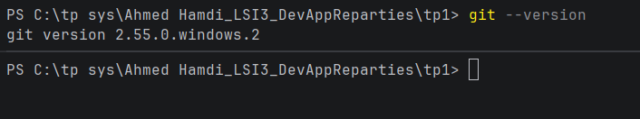

Git est installé : la commande git --version affiche la version installée
(git version 2.55.0.windows.2).

## Étape 2 : Vérification de Java
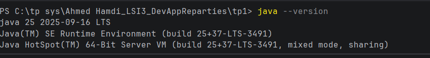

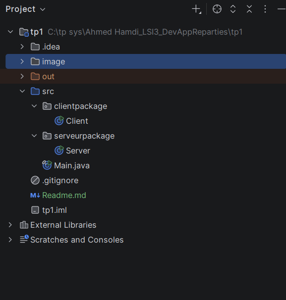

Création du répertoire de travail ahmedhamdi_LSI3_DevAppReparties sur le Bureau.
Il contient le projet TP1-DAR2026.

## Étape 3 : Création du serveur
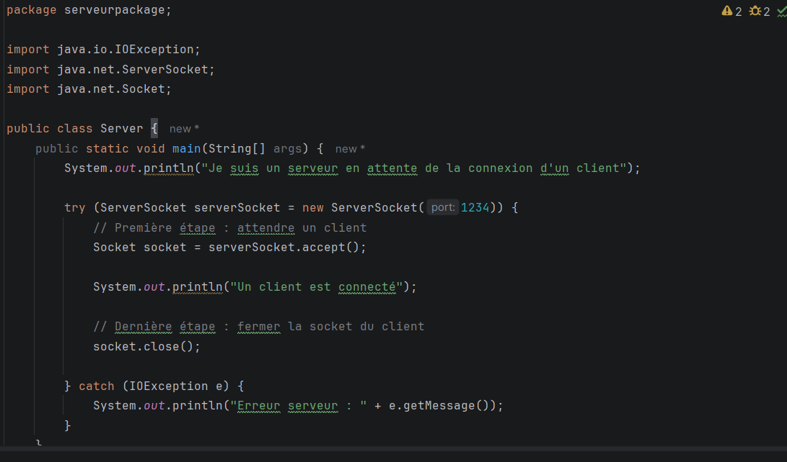

Création du projet TP1-DAR2026 avec dépôt Git, du package serverPackage
et de la classe Server (ServerSocket sur le port 1234, accept(), fermeture des sockets).

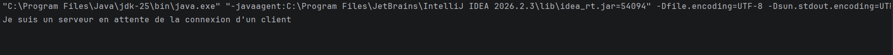

Interprétation : le ServerSocket s'ouvre sur le port 1234, puis accept()
est une méthode bloquante : le serveur attend sans rien faire qu'un client se
connecte. Le message « un client est connecté » n'apparaît pas encore, ce qui
prouve qu'aucun client n'est connecté.

## Étape 4 : Création du client
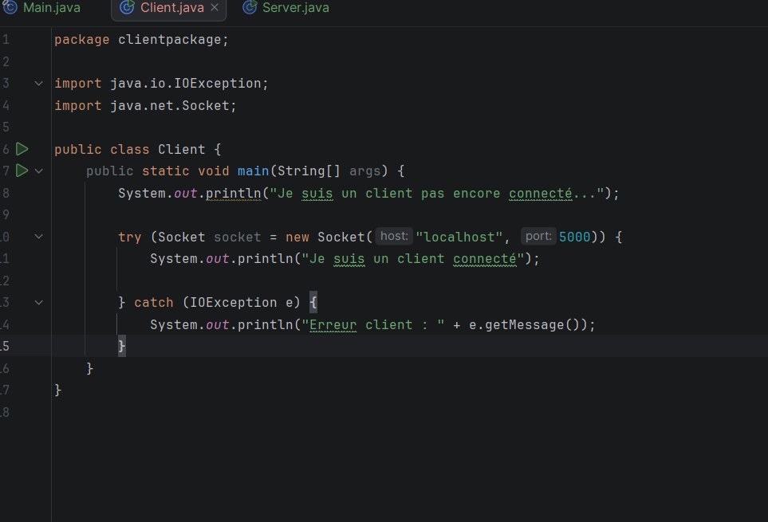
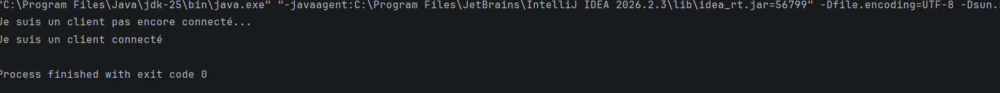

Client lancé avec localhost et le port 1234.

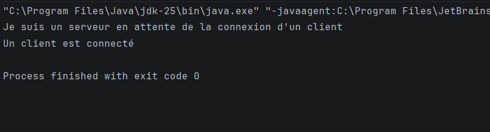

Interprétation : le client crée un Socket vers localhost:1234. Le serveur
débloque son accept() et affiche « un client est connecté ». Le client affiche
« je suis un client connecté » : la connexion TCP est établie. Les deux programmes
se terminent après la fermeture des sockets (Process finished with exit code 0).

---

# Activité 1-2 : Service de calculatrice

## Étape 1 : Préparation de l'espace de travail
Le projet TP1-DAR2026 de l'Activité 1-1 est réutilisé et étendu : le client envoie
un entier au serveur, qui le multiplie par 5 et renvoie le résultat.
Les échanges utilisent DataInputStream et DataOutputStream.

## Étape 2 : Service de multiplication

### Code du serveur
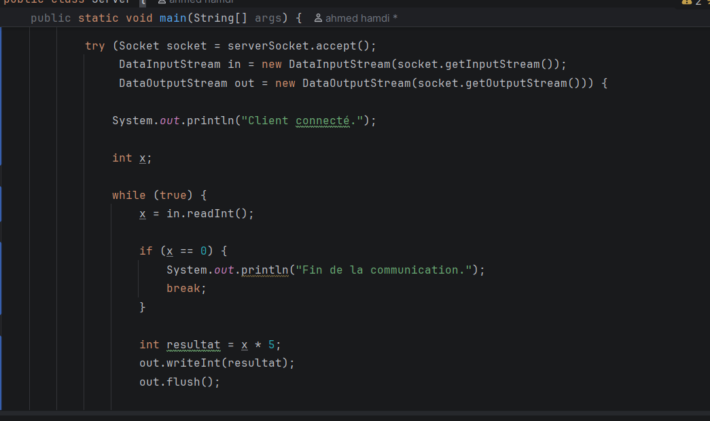

Le serveur attend un client, lit un entier avec readInt(), calcule x * 5,
puis renvoie le résultat avec writeInt().

### Code du client
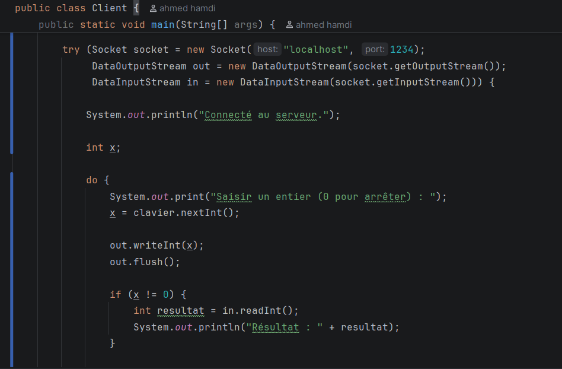

Le client lit un entier au clavier (Scanner), l'envoie avec writeInt(),
puis reçoit et affiche le résultat avec readInt().

### Tests avec différentes valeurs
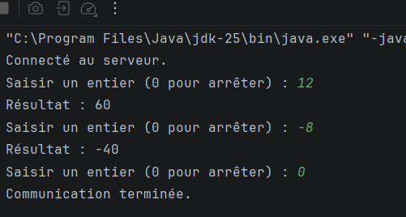
.

---

# Activité 1-3 : Amélioration du service de calculatrice

## Étape 1 : Connexion Client/Serveur avec l'adresse IP réelle

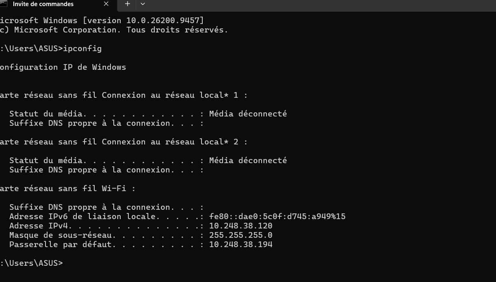

La commande ipconfig donne l'adresse IPv4 de la machine : *10.248.38.120* de ma machine.

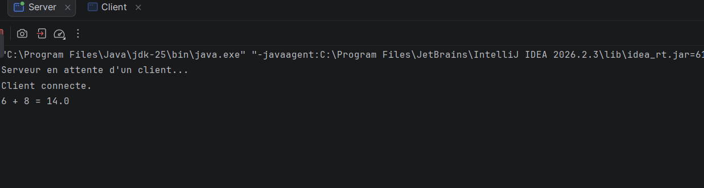

Côté serveur, ma machine : le serveur écoute sur
l'IP réelle de la machine et sur le port 1234 (et non plus sur localhost).

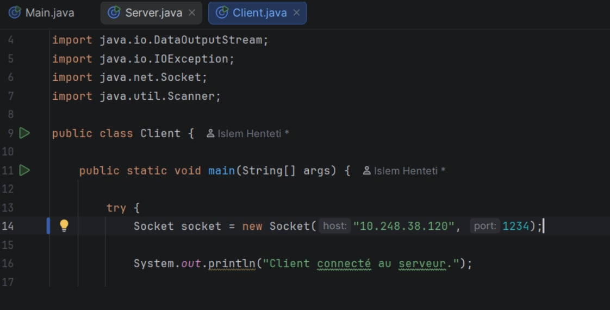

Côté client, localhost est remplacé par l'adresse IP du serveur,

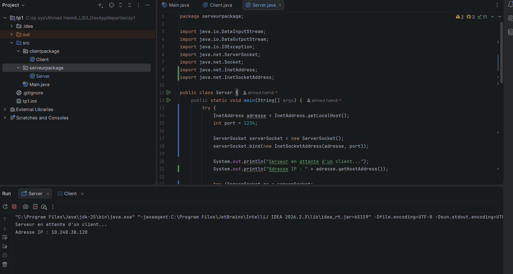

Le serveur affiche qu'il attend sur 10.248.38.120.

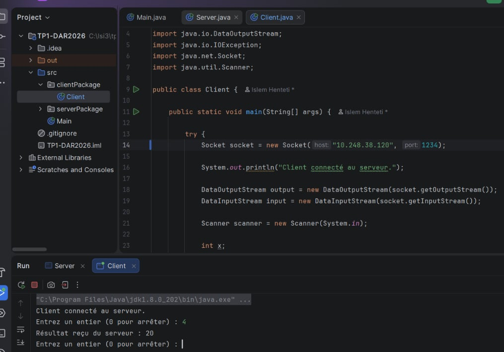

Le client se connecte au serveur en utilisant l'adresse IP réelle.

Le serveur affiche l'adresse IP du client connecté.

## Étape 2 : Service de calculatrice amélioré

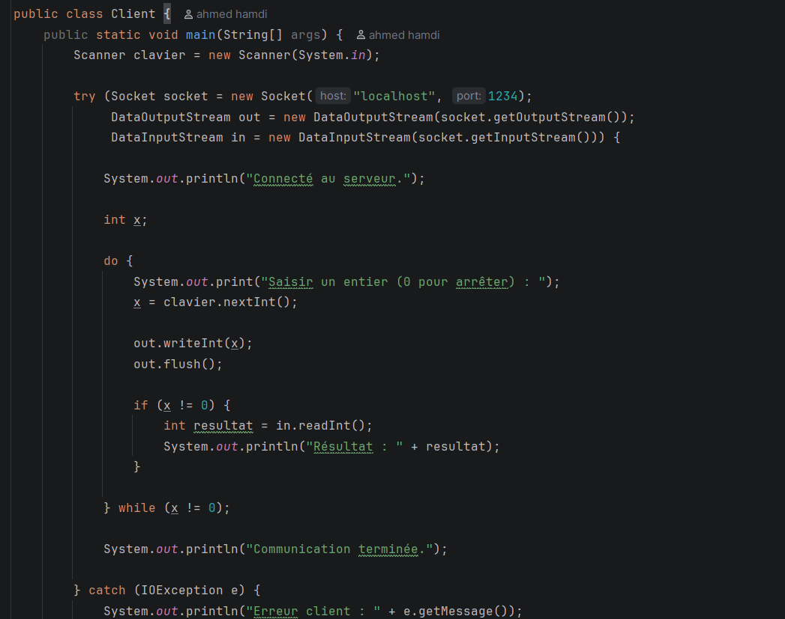

Le client affiche un menu (1. Addition, 2. Soustraction, 3. Multiplication,
4. Division, 0. Quitter), lit le choix puis les deux nombres, et les envoie au serveur
   avec writeInt().

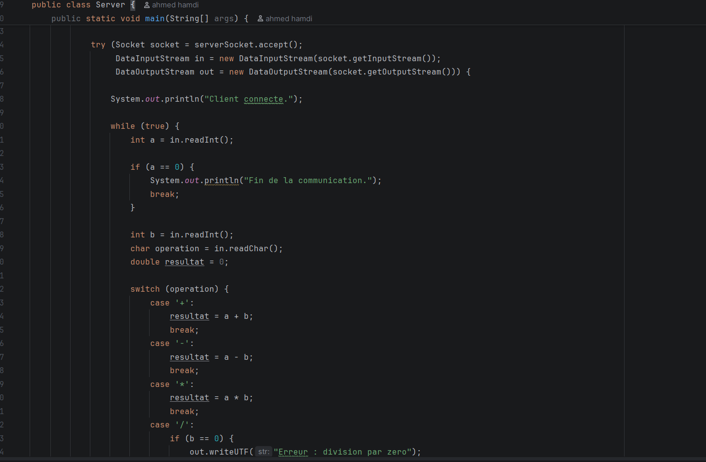

Le serveur lit le choix et les deux nombres, effectue le calcul avec un switch,
puis renvoie le résultat avec writeUTF(). La division par zéro est détectée et
renvoie un message d'erreur.

### Tests

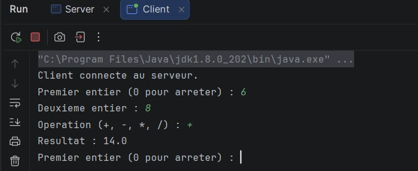

Addition : 8 + 6 = 14.
